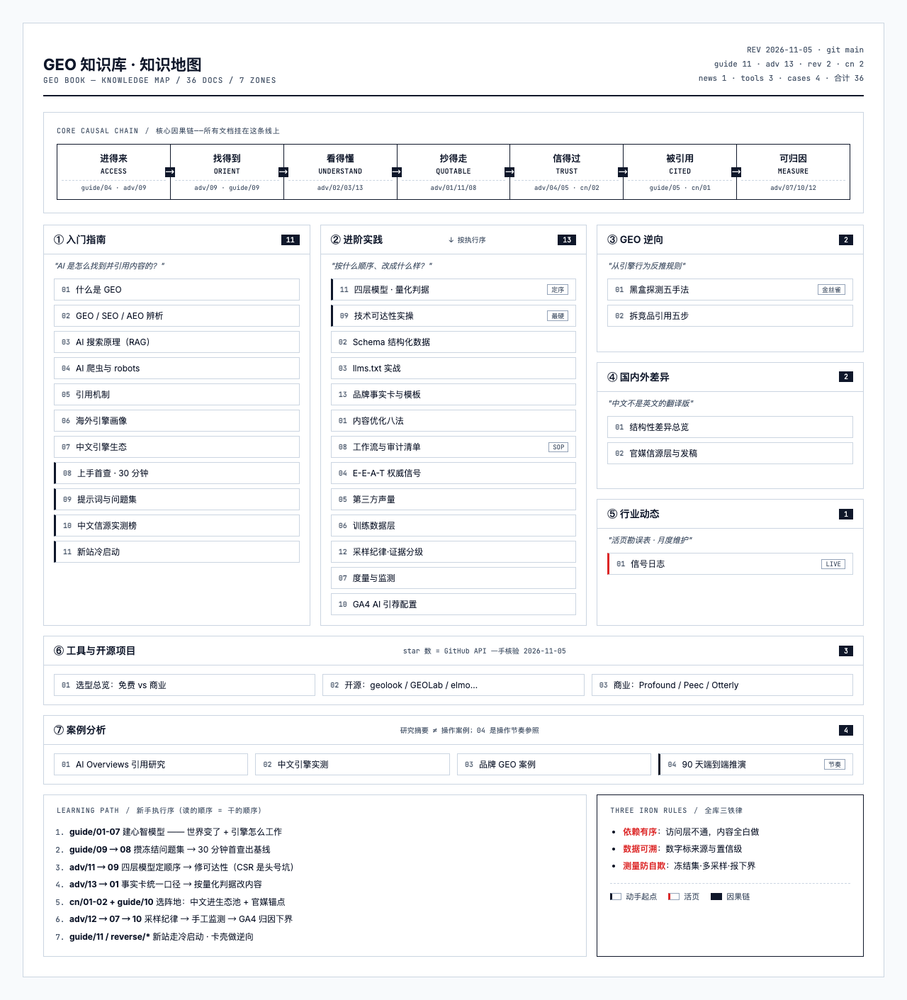

# GEO 知识库（GEO Book）

> Generative Engine Optimization 生成式引擎优化 —— 让 ChatGPT、Perplexity、Google AI Overviews 等 AI 引擎引用你的内容、提及你的品牌。

从零开始系统学习 GEO：基础知识 → 优化实践 → 工具与开源项目 → 案例分析。

**零基础？先读 → [导读：GEO 是一条什么线](docs/WALKTHROUGH.md)**（大白话版主线，10 分钟）

## 知识地图



*高清交互版 → [knowledge-map.html](knowledge-map.html)（浏览器打开）*

## 为什么要学 GEO

- AI 搜索（ChatGPT、AI Overviews、豆包、Kimi）正在分流传统搜索流量，用户越来越多地直接看 AI 生成的答案而不是点蓝色链接。
- Princeton 论文实测：应用 GEO 方法可将内容在生成式引擎回答中的可见度提升最高 40%（来源见 [01-what-is-geo.md](docs/guide/01-what-is-geo.md)）。
- GEO 不是替代 SEO，而是在 SEO 之上叠加"让机器读懂、信任并引用"的一层。

## 目录

### 一、入门指南（docs/guide/）

| 文档 | 一句话简介 |
|------|-----------|
| [01 什么是 GEO](docs/guide/01-what-is-geo.md) | GEO 的定义、起源（Princeton KDD 2024 论文）、为什么重要。 |
| [02 GEO vs SEO vs AEO](docs/guide/02-geo-vs-seo-vs-aeo.md) | 三个概念的区别与联系，一张表看懂各自优化什么。 |
| [03 AI 搜索的工作原理](docs/guide/03-how-ai-search-works.md) | RAG、Embedding、向量检索：AI 引擎如何找到并用你的内容。 |
| [04 AI 爬虫与抓取](docs/guide/04-ai-crawlers.md) | GPTBot、ClaudeBot、PerplexityBot 是谁、robots.txt 该放行还是拦截。 |
| [05 AI 引用机制](docs/guide/05-how-ai-engines-cite.md) | AI 引擎选中并引用一个来源的决策链路：检索、可信度、片段匹配。 |
| [06 主流海外引擎画像](docs/guide/06-major-engines.md) | ChatGPT Search / AI Overviews / Perplexity / Gemini / Grok 各自的信源偏好。 |
| [07 中文 AI 引擎生态](docs/guide/07-chinese-ai-engines.md) | 豆包、DeepSeek、Kimi、元宝的引用行为差异与中文 GEO 打法。 |
| [08 上手首查：30 分钟自检](docs/guide/08-first-audit.md) | 不装工具，30 分钟搞清楚 AI 现在能不能看到你。 |
| [09 提示词与问题集研究](docs/guide/09-prompt-research.md) | AI 时代的关键词研究：五路找问题 + 冻结问题集设计规则。 |
| [10 中文信源生态实测榜](docs/guide/10-cn-source-ranking.md) | 18.7 万条引用实算：官网仅占 1.37%、榜单站霸榜、各引擎生态割据。 |
| [11 新站冷启动](docs/guide/11-cold-start.md) | 零权重新站拿首次引用：时间窗预期、空位题、借势平台、引用寿命。 |

### 二、进阶实践（docs/advanced/）

| 文档 | 一句话简介 |
|------|-----------|
| [01 GEO 内容优化](docs/advanced/01-content-optimization.md) | 结论前置、问答式标题、数据锚点：让 AI 想引用的内容写法。 |
| [02 结构化数据与 Schema](docs/advanced/02-schema-structured-data.md) | FAQPage、Article、Organization 等 JSON-LD 怎么标才有帮助。 |
| [03 llms.txt 实战](docs/advanced/03-llms-txt.md) | Jeremy Howard 提案的格式、现状争议与生成工具。 |
| [04 E-E-A-T 与权威信号](docs/advanced/04-eeat-authority.md) | 经验、专业、权威、可信：AI 判断"值不值得引用"的信号体系。 |
| [05 第三方声量建设](docs/advanced/05-third-party-presence.md) | Reddit、Wikipedia、评测站：AI 训练与检索偏好的第三方阵地。 |
| [06 进入 LLM 训练数据](docs/advanced/06-training-data-visibility.md) | 长期层：Common Crawl、数据授权协议与品牌沉淀。 |
| [07 GEO 度量与监测](docs/advanced/07-measurement.md) | AI 提及率、引用份额、Share of Voice：怎么量化 GEO 效果。 |
| [08 GEO 工作流与审计清单](docs/advanced/08-workflow-checklist.md) | 从诊断到执行到复测的完整落地流程与可复制清单。 |
| [09 技术可达性实操](docs/advanced/09-technical-accessibility.md) | JS 渲染让 AI 隐身？curl 验证、SSR/SSG 修复、IndexNow 提交。 |
| [10 GA4 AI 引荐流量配置](docs/advanced/10-ga4-ai-referral.md) | 把 AI 引荐流量从 GA4 里剥出来：原生渠道 + 自定义正则 + 探索报表。 |
| [11 四层依赖模型与量化判据](docs/advanced/11-four-layer-model.md) | 访问→定向→理解→可引用：修复顺序判据 + 全库最硬量化阈值。 |
| [12 采样纪律与证据分级](docs/advanced/12-sampling-discipline.md) | 防自欺规程：证据 A-D 分级、采样环境四档、API≠Web、归因下界。 |
| [13 品牌事实卡与内容模板](docs/advanced/13-brand-facts-templates.md) | 单一事实源：事实卡骨架 + 定义型/对比型页面可直接套的模板。 |
| [14 引擎偏好规则与内容重写](docs/advanced/14-preference-rules-rewriting.md) | AutoGEO 方法落地：从引擎行为挖偏好规则→按规则重写→双指标防改烂。 |

### 三、工具与开源项目（docs/tools/）

| 文档 | 一句话简介 |
|------|-----------|
| [01 工具总览](docs/tools/01-tools-overview.md) | 监测/优化/审计三类工具选型速查表。 |
| [02 开源项目](docs/tools/02-open-source.md) | GitHub 高星 GEO 项目速查目录：四物种分类、许可证标注、存疑区。 |
| [03 商业监测平台](docs/tools/03-commercial-platforms.md) | Profound、Peec、Otterly、Semrush AIO 等商业平台对比。 |

### 三·五、开源项目深析（docs/projects/）

| 文档 | 一句话简介 |
|------|-----------|
| [01 选型地图](docs/projects/01-selection-map.md) | 四物种分类学 + 决策树 + 许可证/活跃度/数据主权三硬约束 + 刷星存疑区。 |
| [02 实施平台深析](docs/projects/02-implementation-platforms.md) | geolook/GEORank/GEOFlow/GEOInflow：优势-不足-场景三刀切，AGPL 雷区标注。 |
| [03 监测平台对比](docs/projects/03-monitoring-trackers.md) | elmo/limelit/geo-aeo-tracker/oneglanse/gego：引擎覆盖×数据主权×MCP。 |
| [04 Agent 技能包深析](docs/projects/04-agent-skills.md) | gtm/geo-optimizer/yao-geo-skills/geo-doctor/recomby：五包横评，中文支持对比。 |
| [05 研究框架与数据集](docs/projects/05-research-frameworks.md) | AutoGEO/GEOLab/E-GEO/SafeGEO：机理与一手数据，全库数字底座溯源。 |
| [06 内容工厂与工程组件](docs/projects/06-content-factories.md) | GEOFlow 生产管线思想、geoptimize 确定性 lint、dualmark 孪生页、语言级组件。 |

### 四、GEO 逆向（docs/reverse/）

| 文档 | 一句话简介 |
|------|-----------|
| [01 黑盒里探规则](docs/reverse/01-black-box-probing.md) | 把引擎当黑盒：四段管线、五种探测手法（金丝雀页/单变量改写/幽灵引用鉴别）。 |
| [02 拆竞品的引用](docs/reverse/02-competitor-reverse.md) | 竞品金牌页五步拆解法：拆结构、拆阵地、拆差距类型，对症施工。 |

### 五、国内外差异（docs/cn-vs-global/）

| 文档 | 一句话简介 |
|------|-----------|
| [01 结构性差异总览](docs/cn-vs-global/01-structural-differences.md) | 中文 GEO 不是英文版翻译：生态割据、官媒权重、阵地选择先于内容优化。 |
| [02 官媒信源层与发稿](docs/cn-vs-global/02-cn-official-media.md) | 中国特有层：官媒背书的三重机制、合规边界、四步实操与成本预期。 |

### 六、行业动态（docs/news/）

| 文档 | 一句话简介 |
|------|-----------|
| [01 信号日志](docs/news/01-signal-log.md) | 活页勘误表：只收改变打法的已核实信号，每条带"影响"与置信级。 |

### 七、案例分析（docs/case-studies/）

| 文档 | 一句话简介 |
|------|-----------|
| [01 AI Overviews 引用研究](docs/case-studies/01-ai-overview-studies.md) | CXL、Wellows 等机构的引用数据研究说明了什么。 |
| [02 中文引擎实测案例](docs/case-studies/02-cn-engine-tests.md) | 国产六大引擎 12 题实测：引用率与信源偏好一手数据。 |
| [03 品牌 GEO 案例](docs/case-studies/03-brand-cases.md) | Wikipedia 效应 3.2 倍提及、HVAC 本地案例等可借鉴打法。 |
| [04 端到端 90 天实战推演](docs/case-studies/04-end-to-end-90days.md) | 虚拟站点从零到被引用：全库方法论串成一条带时间轴的执行线。 |

## 学习路径

**零基础（第 1 周）**：guide/01 → 09 → 08 → 10，建心智模型 → 建问题集 → 首查出基线 → 看懂中文信源格局。

**修地基（第 2 周）**：advanced/11（四层模型定顺序）→ 09（渲染/爬虫/索引）→ 02 → 03（Schema/llms.txt）。**顺序不能倒：访问层不通，下游全白做。**

**改内容（第 3-4 周）**：advanced/13（事实卡+模板）→ 01（按判据改造），按冻结问题集逐页落地，跑 advanced/08 完整工作流。

**放大与度量（第 5 周起）**：advanced/12（采样纪律）→ 07 → 10（手工协议+GA4 报表），每周跑基线看趋势。

**长期建设**：advanced/04 → 05 → 06 + guide/10 的信源优先级，第三方声量是慢变量，越早越好。

**想提速**：卡在某个问题没思路时，读 reverse/ 两篇——从引擎行为和竞品引用里反推规则，比自己闷头试快。

## 资料口径说明

- 所有数据均标注来源链接；标注"自报数据"的是厂商营销口径，未经独立核验。
- GitHub star 数核验于 2026-11-06（tools/02 与 projects/ 同批）。
- 一手资料：arXiv / GitHub / X.com + CN-GEO 开源数据集实算（中文生态单独成篇）。
- 方法论部分章节蒸馏自开源项目 geolook 的 references 方法层（判据均已溯源到公开实证数据）。

## 项目结构

```
geo-book/
├── README.md            # 本文件：总目录 + 每篇一句话简介
├── SUMMARY.md           # 学习路径与内容总结
├── book.toml            # mdBook 配置（src=docs, build-dir=web）
├── scripts/
│   └── gen-web.py     # 生成 docs/SUMMARY.md（mdBook 导航）+ 构建 web/
├── web/                 # mdBook 构建产物（html 站，勿手改）
└── docs/
    ├── guide/           # 入门指南（10 篇）
    ├── advanced/        # 进阶实践（14 篇）
    ├── tools/           # 工具与开源项目（3 篇·速查目录）
    ├── projects/        # 开源项目深析（选型地图+四物种深析）
    ├── reverse/         # GEO 逆向（2 篇）
    ├── cn-vs-global/    # 国内外差异（2 篇）
    ├── news/            # 行业动态（1 篇·活页）
    └── case-studies/    # 案例分析（4 篇）
```

---

**最后更新**：2026-11-06

技术支持：[Otlume](https://www.otlume.com)
